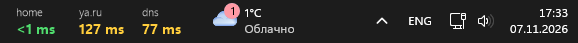

# TaskbarPing

<p align="center">
  
</p>

<p align="center">
  <sub>home / ya.ru / dns on the taskbar: green = fast, yellow = slower, red = lost<br>
  Задержка до сервисов прямо в панели задач: зелёный – быстро, жёлтый – медленнее, красный – связи нет</sub>
</p>

<p align="center">
  <a href="#english">English</a> | <a href="#русский">Русский</a>
</p>

---

## English

A tiny Windows 11 utility that pings your hosts over ICMP and shows the latency **right on the taskbar**, next to the system tray. Give each service a friendly name instead of an IP: `home – 1 ms`, `dns – 20 ms`.

### Features

- Latency of 1–6 hosts displayed on the taskbar, two lines per service: name (gray) and value (colored)
- Color coding:
  - 🟢 green – up to 50 ms (configurable)
  - 🟡 yellow – above that
  - 🔴 red `lost` – connection lost (2 failed pings in a row, so a single dropped packet doesn't flicker)
- Custom names instead of IP addresses; IPs and DNS names are supported
- Follows the system light/dark taskbar theme
- Drag the widget with the mouse to position it; the position is saved
- Right-click menu: reload config, open config, toggle autostart, exit
- Hides itself while a fullscreen app, game or presentation is running
- Per-monitor DPI aware, low CPU and memory usage
- Starts with Windows (enabled on first run, can be turned off in the menu)

### Requirements

- Windows 11 (horizontal taskbar at the bottom)
- [.NET 8 Desktop Runtime](https://dotnet.microsoft.com/download/dotnet/8.0) to run, .NET 8 SDK to build

### Build

```powershell
dotnet publish -c Release -r win-x64 --self-contained false -p:PublishSingleFile=true
```

The result is `bin\Release\net8.0-windows\win-x64\publish\TaskbarPing.exe`.

> **Note:** put the exe in a permanent folder before the first run – autostart stores the path it was launched from. If you move it later, toggle "Run with Windows" off and on again in the menu.

### Configuration

The config is created on first launch at `%AppData%\TaskbarPing\config.json`:

```json
{
  "services": [
    { "name": "home", "host": "192.168.0.1" },
    { "name": "dns",  "host": "1.1.1.1" }
  ],
  "intervalMs": 1000,
  "timeoutMs": 1000,
  "goodMs": 50,
  "offsetX": 170
}
```

| Key | Description |
|---|---|
| `services` | Up to 6 entries: display `name` (max 14 chars) and `host` (IP or DNS name) |
| `intervalMs` | Pause between pings, 500–60000 ms |
| `timeoutMs` | Timeout of a single ping, 200–5000 ms |
| `goodMs` | Latency up to this value is green, higher is yellow |
| `offsetX` | Distance from the notification area to the widget (px at 100% scale); changed by dragging |

Changes are picked up automatically within a couple of seconds (or use "Reload config" in the menu). An invalid config is ignored and the previous settings stay active.

### Security

- Runs as a normal user, no administrator rights required
- Only outgoing ICMP echo requests are sent; no other network connections, no telemetry
- Hosts from the config are validated: only IP addresses and plain DNS names are accepted
- Autostart uses `HKCU\Software\Microsoft\Windows\CurrentVersion\Run` (current user only)
- Single instance only

### How it works

Windows has no official API for taskbar widgets, so TaskbarPing draws a borderless, click-through-where-transparent, topmost layered window (per-pixel alpha) over the taskbar and re-asserts its z-order every second. Pings run asynchronously, one loop per service.

### Limitations

- Only a horizontal taskbar is supported; the widget is shown on the primary monitor
- The taskbar position is read from the shell windows (`Shell_TrayWnd` / `TrayNotifyWnd`), so future Windows updates may require adjustments

### License

Add your license here (e.g. MIT).

---

## Русский

Небольшая утилита для Windows 11: пингует ваши хосты по ICMP и показывает задержку **прямо в панели задач**, рядом с треем. Вместо IP можно задать понятное имя: `home – 1 ms`, `dns – 20 ms`.

### Возможности

- Задержка до 6 хостов в панели задач, две строки на сервис: имя (серым) и значение (цветом)
- Цветовая индикация:
  - 🟢 зелёный – до 50 мс (настраивается)
  - 🟡 жёлтый – выше порога
  - 🔴 красный `lost` – связь пропала (2 неудачных пинга подряд, чтобы один потерянный пакет не мигал)
- Свои имена вместо IP; поддерживаются и IP-адреса, и DNS-имена
- Подстраивается под светлую/тёмную тему панели задач
- Виджет можно перетащить мышью, позиция сохраняется
- Меню по правому клику: перезагрузить конфиг, открыть конфиг, автозапуск, выход
- Прячется, пока открыто полноэкранное приложение, игра или презентация
- Поддержка DPI для каждого монитора, низкая нагрузка на CPU и память
- Запускается вместе с Windows (включается при первом запуске, отключается в меню)

### Требования

- Windows 11 (горизонтальная панель задач снизу)
- [.NET 8 Desktop Runtime](https://dotnet.microsoft.com/download/dotnet/8.0) для запуска, .NET 8 SDK для сборки

### Сборка

```powershell
dotnet publish -c Release -r win-x64 --self-contained false -p:PublishSingleFile=true
```

Результат: `bin\Release\net8.0-windows\win-x64\publish\TaskbarPing.exe`.

> **Важно:** перед первым запуском положите exe в постоянную папку – автозапуск запоминает путь, откуда программа была запущена. Если файл потом переместить, снимите и снова поставьте галочку «Запускать вместе с Windows» в меню.

### Настройка

Конфиг создаётся при первом запуске в `%AppData%\TaskbarPing\config.json`:

```json
{
  "services": [
    { "name": "home", "host": "192.168.0.1" },
    { "name": "dns",  "host": "1.1.1.1" }
  ],
  "intervalMs": 1000,
  "timeoutMs": 1000,
  "goodMs": 50,
  "offsetX": 170
}
```

| Параметр | Описание |
|---|---|
| `services` | До 6 записей: отображаемое имя `name` (до 14 символов) и `host` (IP или DNS-имя) |
| `intervalMs` | Пауза между пингами, 500–60000 мс |
| `timeoutMs` | Таймаут одного пинга, 200–5000 мс |
| `goodMs` | Задержка до этого значения – зелёная, выше – жёлтая |
| `offsetX` | Отступ виджета от области уведомлений (px при масштабе 100%); меняется перетаскиванием |

Изменения подхватываются автоматически в течение пары секунд (или пунктом «Перезагрузить конфиг» в меню). Некорректный конфиг игнорируется, остаются прежние настройки.

### Безопасность

- Работает от обычного пользователя, права администратора не нужны
- Отправляются только исходящие ICMP-запросы; других сетевых подключений и телеметрии нет
- Хосты из конфига проверяются: допускаются только IP-адреса и обычные DNS-имена
- Автозапуск через `HKCU\Software\Microsoft\Windows\CurrentVersion\Run` (только для текущего пользователя)
- Запускается только один экземпляр

### Как это работает

В Windows нет официального API для виджетов панели задач, поэтому TaskbarPing рисует безрамочное прозрачное окно поверх панели (layered window с попиксельной прозрачностью) и раз в секунду возвращает его на передний план. Пинги выполняются асинхронно, по одному циклу на каждый сервис.

### Ограничения

- Поддерживается только горизонтальная панель задач; виджет отображается на основном мониторе
- Положение панели определяется по окнам оболочки (`Shell_TrayWnd` / `TrayNotifyWnd`), поэтому после обновлений Windows может потребоваться доработка

### Лицензия

MIT, см. файл [LICENSE](LICENSE)
